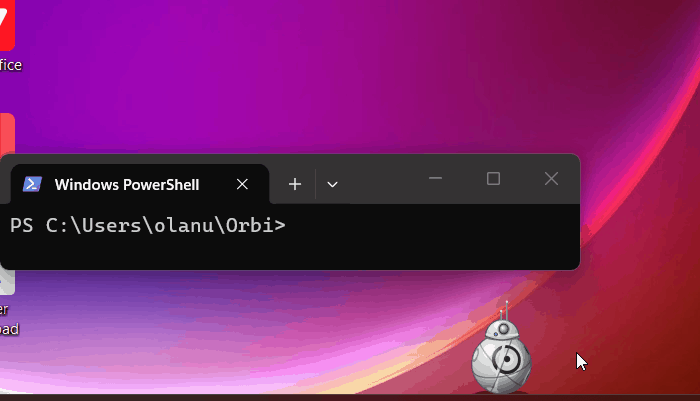

# Orbi

> A little round desktop robot that keeps you company while you code.

Orbi is a small, frameless, always-on-top desktop companion written in Python. He rolls around the bottom of your screen, blinks, looks at your cursor, and reacts to what you're doing. 

He's fully offline. No AI cloud services, no telemetry, no microphone spying. He just sits there, keeps you company, and occasionally talks back.



## ✨ Features

- **Alive & Physical:** Rolls on a real 3D sphere. Blinks, breathes, and tracks your cursor. Drag him around, throw him across the screen, and watch him bounce off the walls.
- **Rocket Jumps:** When you switch windows, Orbi will fire up his rocket boosters and fly straight to the title bar of your new app.
- **Voice-Enabled Rubber Duck:** Double-click Orbi to talk out a bug. You can type, or click the mic and speak. He uses offline speech-to-text (Vosk) to understand you, and Windows TTS to talk back.
- **Developer-Aware:** Reacts when your tests pass/fail, gets nervous on slow builds, and watches your git repos for commits.
- **Health Reminders:** Drink water, stretch, rest your eyes, and fix your posture. Orbi notices if you're away from the keyboard and politely waits for you to return.
- **Focus Timer:** Built-in Pomodoro timer with a visual focus ring.
- **Global CLI Commands:** You can type `orbi pass`, `orbi mood happy`, or `orbi say "hello"` from *anywhere* in your terminal.
- **Deep Customization:** 10 themes, plus a custom color picker. Orbi can also detect if Spotify or YouTube is playing and will nod his head to the beat.
- **Drag & Drop:** Drop a file directly onto Orbi and see his reaction.

## 📥 Installation

You do not need Python installed to run Orbi.

1. Go to the [Releases](https://github.com/MojolaoluwaOlanusi/orbi/releases) page.
2. Download the latest `Orbi-vX.X.X-windows.zip` file.
3. Unzip the folder anywhere on your computer.
4. Run `Orbi.exe`.

**To make him start automatically:**
Right-click the little robot -> **Settings** -> **System** tab -> check **"Start with Windows"**.

## 💻 Terminal Setup (Optional)

To use Orbi from anywhere in your terminal (e.g., `orbi pass`), add his folder to your Windows `PATH`:
1. Create a file named `orbi.bat` in the Orbi folder containing: `@echo off` and `start "" "C:\Path\To\Orbi\Orbi.exe" %*`
2. Search Windows for "Environment Variables".
3. Under "User variables", select "Path" and click Edit.
4. Add the path to your Orbi folder.
5. Restart your terminal.

## 🛠️ Building from Source

If you want to modify the code or build the executable yourself:

**Prerequisites:** 
- Python 3.10+
- Download the [Vosk Small English Model](https://alphacephei.com/vosk/models) and extract it into the project folder so you have an `orbi/model/` directory.

1. Clone the repo:
   ```bash
   git clone https://github.com/YOUR_USERNAME/orbi.git
   cd orbi

2. Install dependencies:
    ```bash
    python -m pip install PySide6 psutil vosk sounddevice

3. Run the build script (this will bundle the model, Vosk, and all dependencies into a standalone exe):
    ```bash
    .\build_orbi.bat

4. Want to just run the source code directly?
    ```bash
    python orbi.py

🔒 Privacy
Orbi is 100% offline. He does not connect to the internet. Your voice is transcribed locally on your machine using Vosk, and your data never leaves your computer.
